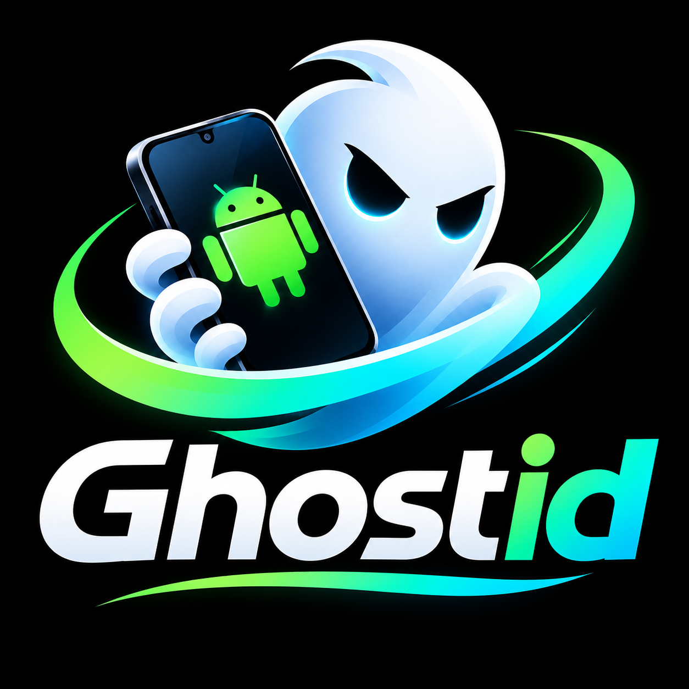

# Ghostid

**Give your AI agent hands on Android.**

One app. Any phone. Your agent taps, types, scrolls and sees the screen — from anywhere.

---

## Why Ghostid

AI agents are great at text. They are terrible at touching a phone.

Every mobile automation stack today needs **a PC, an SDK, or root**:

- **Appium** — desktop server, drivers, capabilities files
- **ADB scripts** — USB cable or pairing ritual, desktop toolchain
- **On-device macro apps** — record-and-replay, no agent, no reasoning

Ghostid removes all of it. The phone **is** the server.

## How it works

1. **Install** — [Ghostid on Google Play](https://play.google.com/store/apps/details?id=com.autokeren.ghostid)
2. **Start the tunnel** — one tap. You get an HTTPS URL like `https://your-tunnel.trycloudflare.com`
3. **Connect your agent** — point any MCP client (Claude Desktop, Cursor, custom) at `POST /mcp` with the bearer token from the app

That's it. No PC. No cable. No root. The agent is now operating a real Android device, anywhere on Earth.

> **New here?** Read the [honest getting-started guide](docs/getting-started.md) � every step, every gotcha, written from a user's experience.

## What your agent can do

| Tool | What it does |
|---|---|
| `screenshot` | See the screen (PNG) |
| `ui_dump` | Read the full UI tree: text, content-desc, bounds |
| `tap` / `swipe` | Touch by coordinates |
| `type_text` | Type into the focused field |
| `keyevent` | HOME, BACK, ENTER, MENU… |
| `open_app` | Launch any app by package |
| `tap_text` / `wait_text` | Find and tap by text — robust against layout changes |
| `shell` | Raw ADB shell (power users) |
| `a11y_*` | Accessibility engine: dump, click, type, scroll, swipe, gestures, intents |

26 tools total. Full reference in [`docs/mcp-tools.md`](docs/mcp-tools.md).

## The Cookbook

Agents are only as good as their recipes.

The [`cookbook/`](cookbook/) folder contains **tested, copy-pasteable recipes** — the exact prompts and tool sequences that make an agent do real things:

| Recipe | What it does |
|---|---|
| [youtube/upload-short](cookbook/youtube/upload-short/) | Publish a video as a YouTube Short |
| [x/post-tweet](cookbook/x/post-tweet/) | Post a tweet with text and image |
| [whatsapp/send-message](cookbook/whatsapp/send-message/) | Send a WhatsApp message |
| [settings/toggle-wifi](cookbook/settings/toggle-wifi/) | Toggle Wi-Fi and verify state |
| [screen/read-notifications](cookbook/screen/read-notifications/) | Read and summarize notifications |

Every recipe follows the [Recipe Format](spec/RECIPE-FORMAT.md) — a small YAML + Markdown standard so the community can contribute and agents can parse.

> **Cooking** — the act of turning an agent intent into a repeatable recipe. Submit yours with a PR.

## Pricing

**Free.** 1,000 calls per day, all 26 MCP tools, tunnel included.

That is a real tier — enough for most daily automations. A Pro tier exists in the app for heavier usage; you will find it when you need it.

## FAQ

**Is this safe?**
Your tunnel URL is public but every endpoint requires the bearer token shown in your app. Rotate the token from the app anytime. Screen data goes only to the agent you connect — never to Ghostid servers.

**Do I need to enable Developer Options?**
For the ADB engine, yes (Wireless Debugging). For the Accessibility engine, no — just the standard Android accessibility toggle. Ghostid explains exactly what it does before you enable it.

**Does it work on any Android?**
Android 11+ (API 30+). Tested on Samsung, Pixel and Xiaomi.

**Is the app open source?**
The app is proprietary. This repository — cookbook, spec, docs — is open (MIT) and community-driven.

## Community

Join the **[Ghostid Discord](https://discord.gg/krANeUdpB)** — get help, share your cooking, and follow releases:

- `#help` — setup questions (the bot answers `/faq pairing`, `/faq screenshot`, …)
- `#showcase` — post what your agent cooked
- `#recipes` — new cookbook recipes land here automatically
- `#dev` — technical discussion

The Discord bot is open too: [`community/discord-bot/`](community/discord-bot/).

## Links

- **App** — [Google Play](https://play.google.com/store/apps/details?id=com.autokeren.ghostid)
- **Website** — [ghostid.autokeren.com](https://ghostid.autokeren.com)
- **MCP spec** — [modelcontextprotocol.io](https://modelcontextprotocol.io)
- **Recipe format** — [spec/RECIPE-FORMAT.md](spec/RECIPE-FORMAT.md)
- **Getting started guide** — [docs/getting-started.md](docs/getting-started.md)
- **Feature reference** — [docs/features.md](docs/features.md)
- **GitHub free build** — [Releases](https://github.com/autokeren/ghostid/releases)
- **FAQ** — [docs/FAQ.md](docs/FAQ.md)

---

**Built for agents, by operators.** — AutoKeren

